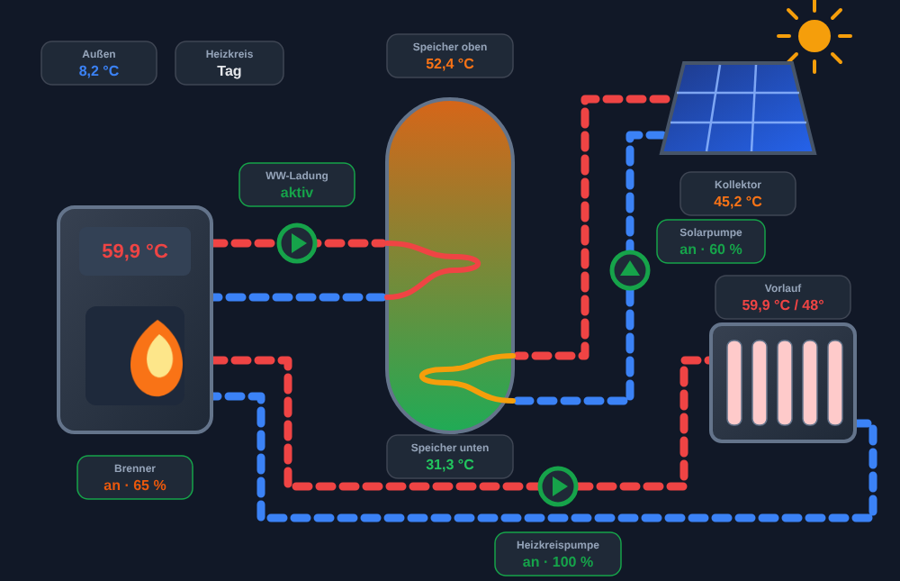
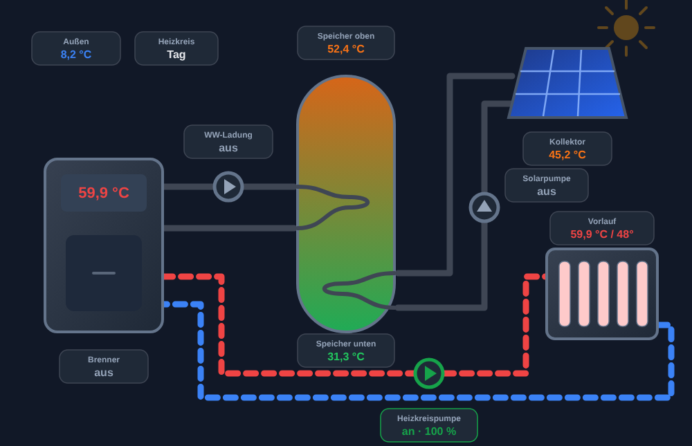

# Buderus Heat Card

Animated all-in-one heating schematic card for Home Assistant: boiler, heating circuit, domestic hot water tank and solar thermal in **one** view. Built for Buderus/Bosch systems connected via [EMS-ESP](https://github.com/emsesp/EMS-ESP32), but works with any entities.

**Read-only by design:** tapping an element only opens the more-info dialog. The card never calls a service, so it cannot change anything on your heating system.



<details>
<summary>Idle state</summary>


</details>

## Features

- Boiler with live temperature display and animated flame while the burner is on
- Charging circuit (boiler → upper heat exchanger of the tank)
- Solar circuit (collector → solar pump → lower heat exchanger)
- Heating circuit with pump and radiator, flow actual / target
- Tank colored by top and bottom temperature
- Animated flow only while the respective pump is running; idle circuits are greyed out
- Follows the Home Assistant light and dark theme, respects `prefers-reduced-motion`

## Installation

### HACS (custom repository)

1. Open **HACS** → three-dot menu → **Custom repositories**
2. Add `https://github.com/pasimatics/buderus-heat-card` with category **Dashboard**
3. Install **Buderus Heat Card** and reload the browser

### Manual

1. Copy `dist/buderus-heat-card.js` to `/config/www/buderus-heat-card/`
2. Add the resource `/local/buderus-heat-card/buderus-heat-card.js` (type: JavaScript module)

## Configuration

```yaml
type: custom:buderus-heat-card
title: Heizungsanlage
entities:
  outside: sensor.boiler_outdoortemp
  boiler_temp: sensor.boiler_boiltemp
  burner: binary_sensor.boiler_burngas
  burner_power: sensor.boiler_curburnpow
  flow: sensor.boiler_curflowtemp
  flow_target: sensor.thermostat_hc1_targetflowtemp
  heating_pump: binary_sensor.boiler_heatingpump
  heating_pump_mod: sensor.boiler_heatingpumpmod
  dhw_charging: binary_sensor.boiler_dhw_charging
  charge_pump: binary_sensor.boiler_dhw_chargepump
  tank_top: sensor.boiler_dhw_curtemp
  tank_bottom: sensor.solar_cylbottomtemp
  collector: sensor.solar_collectortemp
  solar_pump: binary_sensor.solar_solarpump
  solar_pump_mod: sensor.solar_solarpumpmod
  mode: sensor.thermostat_hc1_modetype
```

The entity IDs above are the EMS-ESP defaults (boiler, RC30/RC35 thermostat, SM10 solar module). Adjust them to your installation; any entity left empty is simply not shown.

### Options

| Option | Default | Description |
|---|---|---|
| `title` | `Heizungsanlage` | Card title; set to `""` to hide the header |
| `animation` | `true` | Animated pipe flow |
| `entities` | – | Entity mapping, see below |
| `labels` | – | Override value labels, e.g. `labels: { tank_top: "WW oben" }` |

### Entities

| Key | Typical entity | Shown as |
|---|---|---|
| `outside` | outdoor temperature | value |
| `mode` | heating circuit mode (day/night) | value |
| `boiler_temp` | boiler temperature | boiler display |
| `burner` | burner / flame (on/off) | flame + status |
| `burner_power` | burner modulation (%) | burner value |
| `flow` / `flow_target` | flow temperature actual / target | radiator value |
| `heating_pump` / `heating_pump_mod` | heating pump on/off / modulation | pump + value |
| `charge_pump` / `dhw_charging` | DHW charge pump / charging active | charging circuit |
| `tank_top` / `tank_bottom` | tank temperatures | tank color + values |
| `collector` | collector temperature | value |
| `solar_pump` / `solar_pump_mod` | solar pump on/off / modulation | solar circuit |

Label keys: `outside`, `mode`, `burner`, `charge`, `tank_top`, `tank_bottom`, `collector`, `solar_pump`, `flow`, `heating_pump`.

## Deutsch

Animierte Home-Assistant-Karte mit dem Gesamtschema der Heizungsanlage: Kessel, Heizkreis, Warmwasserspeicher und Solarthermie in einer Ansicht. Gedacht für Buderus/Bosch-Anlagen über EMS-ESP. Die Karte ist eine reine Anzeige: Antippen öffnet nur das Info-Fenster, es werden keine Dienste aufgerufen.
